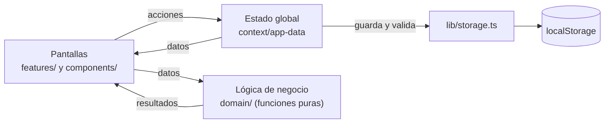

# Moneta · Pitch del proyecto

Guion para armar la presentación en clase. Cada sección es una diapositiva y tiene:

- **Mensaje:** la idea que tiene que quedar.
- **Contenido:** lo que va escrito en la diapositiva.
- **Visual:** qué imagen, captura o diagrama poner.
- **Para decir:** notas para quien presenta.

## Estructura sugerida (unos 15 minutos)

| Bloque | Diapositivas | Tiempo |
| --- | --- | --- |
| Problema y propuesta | 1 a 4 | 3 min |
| Funcionalidades | 5 a 8 | 3 min |
| Demo en vivo | 9 | 3 min |
| Tecnologías y arquitectura | 10 a 13 | 3 min |
| Calidad, aprendizajes y futuro | 14 a 17 | 2 min |
| Cierre y preguntas | 18 | 1 min + preguntas |

---

## 1. Portada

**Contenido**

- **Moneta**
- Administrador inteligente de finanzas personales
- Proyecto final · Tecnicatura Superior en Desarrollo de Software
- [Nombres del equipo] · [Materia y fecha]

**Visual:** captura del dashboard con datos de demostración.

---

## 2. El problema

**Mensaje:** llevar las cuentas personales es tedioso, y por eso casi nadie lo sostiene.

**Contenido**

- Cargar cada gasto a mano en una planilla cansa y se abandona.
- Saber cuánto gastaste no alcanza: falta entender *en qué* y *cuándo*.
- Las apps que dan consejos suelen pedir una cuenta, conectar el banco o mandar los datos a terceros.
- Los consejos genéricos ("gastá menos") no sirven si no usan tus números reales.

**Para decir:** "Todos sabemos que deberíamos controlar los gastos. El problema no es la intención, es que el registro es aburrido y los números sueltos no dicen qué hacer."

---

## 3. La propuesta

**Mensaje:** Moneta registra, muestra, planifica y recomienda, sin pedir cuenta y sin sacar los datos del dispositivo.

**Contenido**

| Registrar | Entender | Planificar | Mejorar |
| --- | --- | --- | --- |
| Movimientos en segundos, incluso desde la foto del ticket | Dashboard, estadísticas y hábitos de gasto | Presupuestos por categoría y objetivos de ahorro | Asistente que da recomendaciones con tus cifras reales |

**Para decir:** "La idea es cubrir el ciclo completo: cargo, veo qué pasó, planifico el mes que viene y recibo sugerencias concretas."

---

## 4. Qué la diferencia

**Mensaje:** no es una planilla con gráficos: tiene lógica propia y respeta la privacidad.

**Contenido**

- **Asistente explicable:** un motor de reglas propio, sin IA externa. Cada recomendación muestra los números que la justifican.
- **Lectura de tickets en el dispositivo:** la foto se procesa en el navegador y no se guarda ni se envía.
- **Sin cuenta ni servidor:** se abre y se usa. Los datos quedan en el navegador y se pueden exportar como respaldo.
- **Se instala como una app:** desde el navegador, sin pasar por una tienda, y abre aunque no haya conexión.
- **Lista para probar:** al entrar por primera vez se puede elegir entre 6 meses de datos de demostración o una cuenta limpia.

**Para decir:** "Elegimos reglas propias en lugar de IA para que cada consejo sea predecible, verificable y explicable. Si el asistente dice que gastaste un 30% más en restaurantes, se puede comprobar."

---

## 5. Funcionalidades: registrar

**Mensaje:** cargar un gasto tiene que ser más rápido que no hacerlo.

**Contenido**

- **Nuevo movimiento siempre a mano:** botón fijo en la barra superior de todas las pantallas.
- **Movimientos:** alta, edición y eliminación con opción de deshacer.
- Búsqueda sin importar tildes; filtros por tipo, categoría y fechas; orden y paginación.
- Montos en formato local: `15000`, `15.000` o `15.000,50`.
- **Lectura de tickets:** se adjunta o se saca la foto, y la app completa comercio, monto y fecha y sugiere la categoría según gastos anteriores.

**Visual:** captura del formulario de gasto con un ticket adjuntado y los campos completados.

**Para decir:** "La lectura de tickets solo completa los campos vacíos y siempre muestra lo que encontró para revisarlo antes de guardar. No reemplaza al usuario, le ahorra tipeo."

---

## 6. Funcionalidades: entender

**Mensaje:** los mismos datos, mirados desde tres ángulos.

**Contenido**

- **Dashboard:** saldo, ingresos, gastos y balance del mes comparados con el mes anterior; gráficos y últimos movimientos.
- **Estadísticas:** 3, 6 o 12 meses; ranking de categorías; comparación libre entre dos meses; gasto por día de la semana.
- **Hábitos financieros:**
  - **Ritmo del mes:** cuánto se gasta al inicio, al medio y al cierre.
  - **Compras repetidas:** lo que se compra seguido.
  - **Estabilidad:** qué categorías son parejas y cuáles son irregulares.

**Visual:** captura de la pantalla de Hábitos.

---

## 7. Funcionalidades: planificar

**Mensaje:** pasar de mirar el pasado a decidir el próximo mes.

**Contenido**

- **Presupuestos:** límite por categoría y mes, alertas al 80% y al 100%, monto diario disponible y límite sugerido según el historial.
- **Copiar** los presupuestos del mes anterior con un clic.
- **Objetivos de ahorro:** aportes y retiros, y un simulador por fecha límite o por aporte mensual.
- El simulador indica si el objetivo es **viable** según la capacidad real de ahorro.

**Visual:** captura de un objetivo con la proyección del simulador.

---

## 8. Funcionalidades: el asistente

**Mensaje:** el asistente convierte los números en acciones concretas.

**Contenido**

- **Puntaje de salud financiera** de 0 a 100.
- **13 reglas:** balance, presupuestos, proyección de cierre, tasa de ahorro (regla 50/30/20), gastos hormiga, suscripciones, fondo de emergencia y más.
- Recomendaciones ordenadas por prioridad: alerta, atención, sugerencia y logro.
- Detecta gastos recurrentes y suscripciones automáticamente.
- Muestra cómo funciona el algoritmo dentro de la misma pantalla.

**Visual:** captura del asistente con el puntaje y dos o tres recomendaciones.

---

## 9. Demo en vivo

**Mensaje:** mostrar el recorrido de una persona real en 3 minutos.

**Recorrido sugerido**

1. **Página de inicio:** mostrar la landing y entrar con "Empezar a usar Moneta".
2. **Bienvenida:** elegir "datos de demostración".
3. **Dashboard:** cambiar de mes y mostrar la comparación con el mes anterior.
4. **Nuevo gasto con ticket:** tocar "Nuevo movimiento" en la barra superior, adjuntar una foto y mostrar cómo se completan los campos.
5. **Presupuestos:** mostrar una categoría en alerta y la sugerencia de límite.
6. **Hábitos:** explicar el tramo del mes con más gasto.
7. **Asistente:** leer una recomendación y mostrar las cifras que la justifican.
8. **Menú e instalación:** abrir el menú lateral, mostrar la app en tamaño de celular (es el mismo diseño) e instalarla desde el navegador.

**Antes de presentar**

- Abrir la app una vez con internet y leer un ticket de prueba: la primera lectura descarga el motor de reconocimiento.
- Para mostrar la instalación, usar la app publicada o `pnpm build` + `pnpm preview`: en `pnpm dev` no se puede instalar. Si ya estaba instalada en esa compu, desinstalarla antes.
- Tener una foto de ticket nítida a mano.
- Tener capturas de respaldo por si falla algo en vivo.

---

## 10. Tecnologías

**Mensaje:** un stack moderno, tipado y sin servidor.

**Contenido**

| Área | Herramienta | Para qué |
| --- | --- | --- |
| Interfaz | React 19 + TypeScript (modo estricto) | Componentes y tipos en todo el código |
| Build | Vite 7 | Desarrollo rápido y build optimizado |
| Estilos | Tailwind CSS 4 | Tokens de diseño propios |
| Navegación | React Router 7 | Rutas con carga diferida |
| Gráficos | Recharts 3 | Todos los gráficos con un estilo unificado |
| Lectura de tickets | Tesseract.js 7 | Reconocimiento de texto dentro del navegador |
| Instalación (PWA) | vite-plugin-pwa 2 | Manifiesto y service worker para instalarla y abrirla sin conexión |
| Datos | `localStorage` | Persistencia sin backend |
| Calidad | ESLint 9 + Vitest 4 | Análisis estático y pruebas unitarias |

**Para decir:** "No hay backend: toda la app corre en el navegador. Eso simplifica el despliegue y protege la privacidad, y la arquitectura está preparada para sumar un servidor después."

---

## 11. Arquitectura

**Mensaje:** la lógica de negocio está separada de la interfaz. Los componentes no calculan.

**Visual:** este diagrama (GitHub lo dibuja solo; se puede sacar una captura):

**Contenido**

- `features/`: una carpeta por pantalla.
- `components/`: componentes reutilizables (botones, tarjetas, modales, gráficos).
- `domain/`: toda la lógica, en funciones puras sin React. Es la única fuente de cálculo.
- `context/`: estado global con un reducer.
- `lib/storage.ts`: único punto que lee y escribe en el navegador.

**Para decir:** "Si el dashboard y estadísticas muestran el total del mes, los dos llaman a la misma función. Por eso los números nunca se contradicen entre pantallas, y por eso podemos probar la lógica sin abrir un navegador."

---

## 12. Flujo de datos

**Mensaje:** una sola fuente de verdad, y todo lo demás se deriva de ella.

**Contenido**

1. Toda la información vive en un único objeto `AppData`.
2. Cada cambio pasa por `appDataReducer`, que también aplica reglas como "si borro un aporte, se descuenta del objetivo".
3. Después de cada cambio se guarda automáticamente y se sincronizan las otras pestañas abiertas.
4. Al cargar o importar un respaldo, los datos se validan y se descartan los registros dañados.
5. Saldo, estadísticas, alertas y recomendaciones se recalculan a partir de los movimientos.

**Visual:** una flecha circular: acción → reducer → estado → guardado → pantallas.

---

## 13. Algoritmos destacados

**Mensaje:** detrás de cada pantalla hay lógica propia, no solo gráficos.

**Contenido**

- **Gastos recurrentes:** un gasto es recurrente si aparece en al menos 3 meses, más o menos una vez por mes, y con montos estables (varían como máximo un 20%).
- **Proyección de cierre:** cuenta los gastos fijos una sola vez y proyecta solo el gasto variable según el ritmo diario.
- **Puntaje de salud:** ahorro (35 puntos), presupuestos (25), tendencia de gasto (20) y objetivos (20).
- **Lectura de tickets:** busca la línea *Total* o *A pagar*. Si no la encuentra, usa el mayor importe, descartando fechas y números de CUIT.
- **Hábitos:** las compras repetidas son el complemento de los recurrentes: se compran más de una vez y media por mes.

**Para decir:** "Agregar una regla nueva al asistente es sumar un objeto a una lista. Cada regla recibe el mismo contexto ya calculado y devuelve recomendaciones con cifras."

---

## 14. Calidad

**Mensaje:** la lógica está probada y el código es consistente.

**Contenido**

- **158 pruebas unitarias en 14 archivos**, todas pasando.
- Se prueba toda la lógica de negocio: validaciones, estadísticas, presupuestos, objetivos, asistente, hábitos, tickets y fechas.
- TypeScript en modo estricto y ESLint en todo el proyecto.
- **Accesibilidad:** foco visible, diálogos accesibles, etiquetas en todos los controles y respeto de la preferencia de reducir movimiento.
- **Paleta apta para daltonismo:** las leyendas siempre muestran nombre, porcentaje y monto, así que nada depende solo del color.
- **Diseño adaptable:** el mismo diseño en celular y escritorio, con barra superior y menú lateral deslizable; en celular los formularios se abren como hoja inferior.

**Visual:** captura de la terminal con `pnpm test` en verde.

---

## 15. El proyecto en números

| Cifra | Qué es |
| --- | --- |
| 10 | Pantallas (página de inicio, dashboard, movimientos, presupuestos, estadísticas, hábitos, objetivos, asistente, configuración y bienvenida) |
| 13 | Reglas del asistente financiero |
| 158 | Pruebas unitarias |
| ~10.800 | Líneas de TypeScript, sin contar pruebas |
| 0 | Servidores o APIs externas para guardar datos |

---

## 16. Desafíos y aprendizajes

**Mensaje:** lo difícil no fue dibujar pantallas, fue que los números siempre cierren.

**Contenido**

- **Consistencia:** si se edita o borra un movimiento que salió de un aporte, el objetivo se ajusta solo.
- **Montos en formato local:** distinguir `15.000` (quince mil) de `15.50` (quince con cincuenta).
- **Fechas:** años bisiestos, fin de mes y fechas locales en lugar de UTC.
- **Texto de tickets:** el reconocimiento devuelve texto con errores, así que la extracción tiene que ser tolerante y nunca guardar sin que el usuario revise.
- **Separar lógica de interfaz desde el principio:** eso hizo posible probar casi todo sin navegador.

---

## 17. Próximos pasos

**Mensaje:** la base está lista para crecer.

**Contenido**

- **Backend con cuentas de usuario:** usar la app desde varios dispositivos sin perder datos. El diseño completo está en [`docs/backend.md`](backend.md).
- **Migración automática** de los datos que hoy están en el navegador.
- **Historial de aportes** a los objetivos de ahorro.
- **Sincronización sin conexión:** la app ya abre sin internet; con el servidor, guardar los cambios hechos sin conexión y enviarlos al reconectar.

**Para decir:** "Como toda la persistencia está concentrada en un solo lugar, conectar un servidor no obliga a reescribir las pantallas."

---

## 18. Cierre

**Contenido**

- **Moneta:** registrá, entendé, planificá y mejorá tus finanzas.
- ¡Gracias! ¿Preguntas?
- [Link al repositorio o a la app publicada]

---

## Anexo: preguntas que pueden hacer

**¿Por qué no usaron inteligencia artificial para el asistente?**
Porque queríamos recomendaciones predecibles y explicables. Con reglas propias, cada consejo se puede verificar con los números, se puede probar y no depende de un servicio pago ni de enviar datos personales a terceros.

**¿Qué pasa si borro los datos del navegador?**
Hoy se pierden, por eso existe la exportación de respaldos en JSON. Es la principal limitación actual y la razón del backend planificado en `docs/backend.md`.

**¿Es seguro cargar la foto de un ticket?**
Sí: la foto se procesa en el mismo navegador y no se guarda ni se envía. Solo la primera vez hace falta internet para descargar el motor de reconocimiento.

**¿Cómo se agrega una regla nueva al asistente?**
Se escribe un objeto con `id`, `name`, `description` y una función `evaluate` que recibe el contexto del mes y devuelve recomendaciones. Después se suma a la lista `ASSISTANT_RULES`.

**¿Cómo prueban que los cálculos están bien?**
Toda la lógica son funciones puras en `src/domain/`, así que se prueban con Vitest sin abrir un navegador. Hay una fábrica de datos de ejemplo para que cada prueba declare solo lo que necesita.

**¿Funciona en el celular?**
Sí: tiene el mismo diseño en celular y en escritorio, se puede agregar a la pantalla de inicio como una app y, al cargar un gasto, se puede sacar la foto del ticket directamente con la cámara.

**¿Funciona sin internet?**
Sí, después de la primera visita: el service worker guarda la app en el dispositivo y los datos ya están en el navegador. La excepción es la lectura de tickets, que necesita internet para descargar el motor de reconocimiento.
